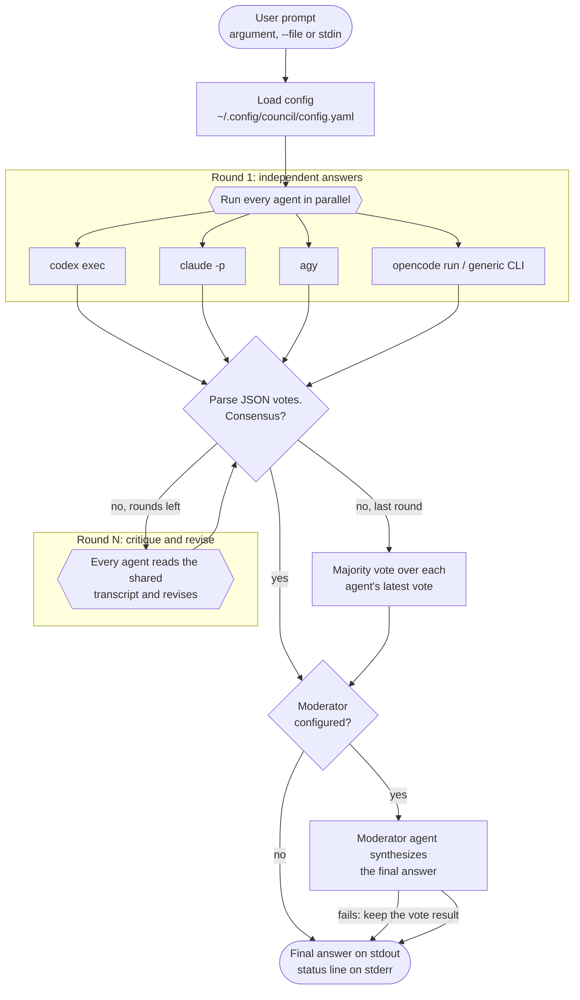
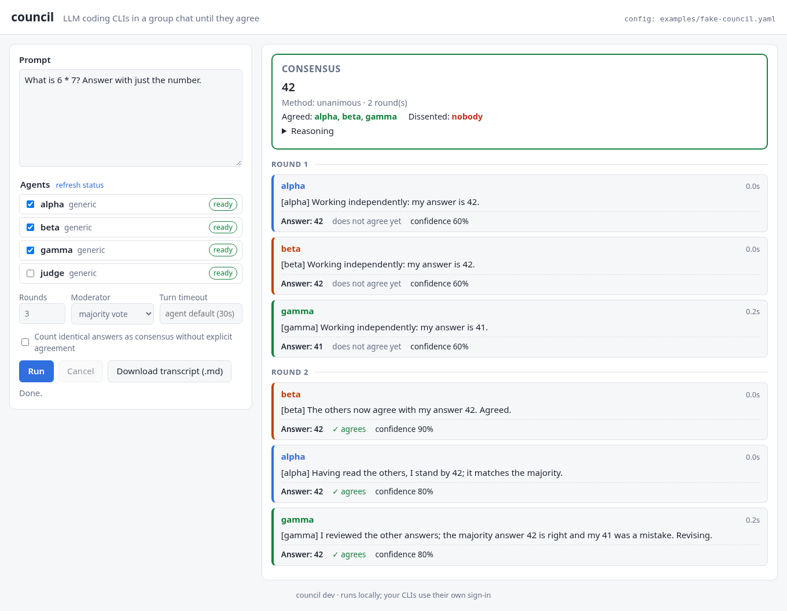

# council

`council` puts several LLM coding CLIs ("harnesses") into one group chat and
returns the group's **consensus answer**.

You ask a question once. OpenAI Codex, Claude Code, Google Antigravity,
OpenCode, and any other CLI you configure each answer it on their own.
Then they read each other's answers, critique them and revise. Every turn ends
with a small JSON vote. The chat stops when everyone agrees, or after a fixed
number of rounds. The final answer comes from that consensus, a majority vote,
or a moderator agent that writes a synthesis.

```console
$ council ask "Is sync.RWMutex faster than sync.Mutex for a read-heavy map in Go?"
…the supporting agent's explanation…

Final answer: Usually yes for read-heavy workloads with long critical sections, …
── consensus after 2 round(s) · method: unanimous · for: codex, claude, agy
```

* **No API keys of its own.** council runs the CLIs you already have installed
  and signed in. It never reads or stores credentials.
* **Any CLI can join.** Besides the four built-in adapters, a `generic` harness
  can drive any command that takes a prompt (argument, stdin or file) and
  prints an answer (text, JSON or JSON Lines).
* **Single static binary** for macOS, Linux and Windows. Nothing to install at
  runtime besides the harness CLIs themselves.

## Contents

- [How it works](#how-it-works)
- [Install](#install)
- [Quick start](#quick-start)
- [Signing in to each harness](#signing-in-to-each-harness)
- [Web UI](#web-ui)
- [Command reference](#command-reference)
- [Configuration](#configuration)
- [How consensus works](#how-consensus-works)
- [Try it without any LLM CLI](#try-it-without-any-llm-cli)
- [Troubleshooting](#troubleshooting)
- [Limitations](#limitations)
- [Further documentation](#further-documentation)
- [Development](#development)
- [License](#license)

## How it works



1. **Round 1:** every agent gets the request and answers on its own. All agents
   run at the same time, each as its own subprocess.
2. **Round 2 and later:** every agent gets the request plus the full transcript of
   the earlier rounds. It is asked to point out mistakes, revise its answer and
   copy the wording of an answer it endorses. The last round is announced as
   final.
3. **Votes:** every message must end with a fenced JSON block:

   ````
   ```json
   {"final_answer": "…", "agree": true, "agrees_with": ["claude"], "confidence": 0.8}
   ```
   ````

4. **Consensus:** the chat stops as soon as every responding agent voted for the
   same (normalized) answer and, from round 2 on, set `"agree": true`.
5. **Decision:** without consensus, the latest vote of each agent is tallied by
   majority. With `--moderator <agent>`, that agent then reads the whole
   discussion and writes the final answer.

[docs/ARCHITECTURE.md](docs/ARCHITECTURE.md) has the full lifecycle and
[docs/CONSENSUS.md](docs/CONSENSUS.md) has the exact rules.

### Built-in harnesses

| Agent / kind | CLI | Invocation used by council | Answer taken from |
|---|---|---|---|
| `codex` | OpenAI Codex CLI | `codex exec --skip-git-repo-check --ephemeral --sandbox read-only --color never --output-last-message <tmp> -` (prompt on stdin) | the `--output-last-message` file |
| `claude` | Claude Code | `claude -p --output-format json --no-session-persistence` (prompt on stdin) | `.result`; `.is_error` marks failure |
| `agy` (kind `antigravity`) | Google Antigravity CLI | `agy --input-format stream-json --output-format stream-json`, prompt sent as one `{"event":"user","message":{"content":…}}` line on stdin | `result.response` of the last event that has it; `result.error` marks failure |
| `opencode` | OpenCode | `opencode run --format json --agent plan` (prompt on stdin; the read-only Plan agent) | `part.text` of the last `text` event; an `error` event marks failure |
| anything else | `generic` | your own command template | text, a JSON path, or a JSON Lines path |

[docs/HARNESSES.md](docs/HARNESSES.md) describes each adapter in detail and how
to add your own. The Gemini CLI adapter was removed in v0.2.1 because Gemini
CLI is deprecated; use `agy` (Google's Antigravity CLI) instead.

## Install

### Prebuilt binaries

Each release ships one static binary per platform plus a `SHA256SUMS` file.
Get them from the repository's GitHub Releases page, or build them yourself
with `make dist` (they land in `dist/`).

| Platform | File |
|---|---|
| macOS, Apple silicon (M1 and later) | `council-darwin-arm64` |
| macOS, Intel | `council-darwin-amd64` |
| Linux, x86-64 | `council-linux-amd64` |
| Linux, ARM64 (Graviton, Raspberry Pi 4/5 with a 64-bit OS) | `council-linux-arm64` |
| Windows, x86-64 | `council-windows-amd64.exe` |

Check the download against `SHA256SUMS` before you run it:

```sh
grep council-linux-amd64 SHA256SUMS | sha256sum -c -        # Linux
grep council-darwin-arm64 SHA256SUMS | shasum -a 256 -c -   # macOS
```

#### Linux

```sh
chmod +x council-linux-amd64
sudo mv council-linux-amd64 /usr/local/bin/council   # or ~/.local/bin/council
council version
```

#### macOS

The binaries are not signed or notarized, so Gatekeeper blocks a downloaded
copy with *"council" cannot be opened because the developer cannot be
verified*. Remove the quarantine attribute that the browser added, then run it
as usual:

```sh
chmod +x council-darwin-arm64
xattr -d com.apple.quarantine council-darwin-arm64   # "No such xattr" is fine: nothing to remove
sudo mv council-darwin-arm64 /usr/local/bin/council
council version
```

If you already tried to open it, you can also allow it under **System Settings
→ Privacy & Security → "council" was blocked… → Open Anyway**. Binaries you
build yourself, or fetch with `curl`, have no quarantine attribute.

#### Windows

1. Rename `council-windows-amd64.exe` to `council.exe` and move it to a folder
   on your `PATH` (for example `%USERPROFILE%\bin`, added through *Edit the
   system environment variables → Environment Variables…*).
2. If SmartScreen says *Windows protected your PC*, choose **More info → Run
   anyway**. Or unblock the file once in PowerShell:

   ```powershell
   Unblock-File "$env:USERPROFILE\bin\council.exe"
   Get-FileHash "$env:USERPROFILE\bin\council.exe" -Algorithm SHA256   # compare with SHA256SUMS
   council version
   ```

3. council is a console program. Run it from PowerShell, Windows Terminal or
   `cmd.exe`.

Notes for Windows:

* The config file is `%USERPROFILE%\.config\council\config.yaml`, unless you set
  `COUNCIL_CONFIG` or `XDG_CONFIG_HOME`.
* CLIs installed with npm are `.cmd` shims (`claude.cmd`, `opencode.cmd`, …). Go
  finds them through `PATHEXT`. If `council doctor` reports one as missing,
  set `command:` to its full path in the config.
* When a turn times out, council kills the CLI process. On Windows it cannot
  kill the whole process tree (Unix kills the whole process group), so child
  processes a CLI started may keep running.
* The `-` stdin marker and pipes work the same as on Unix:
  `Get-Content q.md | council ask`.

### With `go install`

Requires Go 1.24 or newer. The repository is private, so tell Go not to use the
public module proxy, and make sure `git` can authenticate to GitHub (SSH key or
credential helper):

```sh
export GOPRIVATE=github.com/Parsa2820/*
go install github.com/Parsa2820/council/cmd/council@latest
```

The binary goes to `$(go env GOPATH)/bin`. Builds made this way report
`council dev` from `council version`, because the version is only stamped by
the Makefile and `scripts/build.sh`.

### From source

```sh
git clone git@github.com:Parsa2820/council.git
cd council
make            # go vet, go test, then build ./council for this machine
make cover      # unit tests with per-package and per-function coverage
make dist       # cross-compile every release target into dist/ (+ SHA256SUMS)
make zip        # dist/ zipped into ../council-binaries.zip
```

The unit tests need no LLM CLI, network or credentials: the built-in
harnesses are tested against fake `codex`, `claude`, `agy` and `opencode`
scripts. Statement coverage is 99.5% on Linux and macOS (every package at
98.9% or more) and 81.3% on Windows, which skips the shell-script tests; see [CONTRIBUTING.md](CONTRIBUTING.md#tests) for details.

`make build` stamps the version from `git describe --tags --always --dirty`.
Override it with `make build VERSION=v0.1.0`. Builds use `CGO_ENABLED=0` and
`-trimpath`, so the binaries are static and contain no local paths.

### Harness CLIs

council does not bundle any model. Install at least one harness CLI (two or
more for a real discussion) and follow each project's own instructions. At the
time of writing:

```sh
npm install -g @openai/codex            # codex
npm install -g @anthropic-ai/claude-code   # claude
curl -fsSL https://antigravity.google/cli/install.sh | bash   # agy (Antigravity CLI)
npm install -g opencode-ai              # opencode
```

## Quick start

```sh
council init                 # write ~/.config/council/config.yaml (commented)
council doctor               # which harnesses are installed and signed in?
council login claude         # runs `claude auth login`
council login codex          # runs `codex login`
council doctor --probe       # send a one-line prompt through each one

council ask "What is the time complexity of Go's sort.Slice?"
```

By default `council ask` uses `codex`, `claude` and `agy`, up to 3 rounds,
and a majority vote. Pick different agents with `--agents`:

```sh
council ask --agents claude,opencode "…"
council ask --agents codex,claude,agy,opencode --rounds 4 --moderator claude "…"
```

Common ways to pass the prompt:

```sh
council ask "prompt"                                 # prompt as argument
echo "prompt" | council ask                          # prompt on stdin
council ask -f question.md                           # prompt from a file
git diff | council ask "Review this diff" -          # argument + stdin ("-")
council ask -f spec.md "Which design is simplest?"   # argument + file
```

The answer goes to **stdout**. The one-line status (`── consensus after 2
round(s) · method: unanimous · for: …`), notes and the `--verbose` live chat go
to **stderr**. So `council ask … > answer.txt` captures only the answer.

## Signing in to each harness

council never handles credentials. `council login <agent>` runs the CLI's own
login command in your terminal: stdin, stdout and stderr are passed through,
and everything after `--` is appended to it. `council doctor` checks each
harness afterwards.

| Agent | `council login <agent>` runs | Useful extra arguments | How `council doctor` checks auth |
|---|---|---|---|
| `codex` | `codex login` (ChatGPT sign-in in the browser) | `-- --device-auth` on a headless machine; `-- --with-api-key` to read an API key from stdin | `codex login status`, exit 0 = signed in |
| `claude` | `claude auth login` | `-- --console` (Anthropic Console / API billing), `-- --sso` | `claude auth status`, exit 0 = signed in |
| `agy` | `agy` (interactive): sign in with Google (prints a URL over SSH), then type `/quit`; the session goes to the OS keyring | none | `agy models` (no tokens used): it lists models when signed in and fails with "Please sign in to view available models" when not |
| `opencode` | `opencode auth login` (pick a provider, paste a key or sign in) | `-- --provider anthropic` | `opencode auth list`: counts stored credentials and provider env vars. Always `ok`, because OpenCode's free models need no account; the detail says when no provider is configured |
| generic | `<command> <login_args…>` if `login_args` is set | anything after `--` | `<command> <status_args…>`, exit 0 = signed in, if `status_args` is set; otherwise `unknown` |

Examples:

```sh
council login codex -- --device-auth
printenv OPENAI_API_KEY | council login codex -- --with-api-key
council login claude -- --console
council login opencode -- --provider anthropic
council doctor --probe agy opencode   # prove that agy and opencode really answer
```

An `unknown` auth state is not an error. Use `council doctor --probe` for a
definite answer: a successful probe upgrades `unknown` to `ok`, and a failed
probe marks the agent `missing`.

## Web UI



```sh
council serve --open        # http://127.0.0.1:8787/ in your browser
```

`council serve` runs a small web page for the council: type a prompt, tick
the agents (each shows whether it is installed and signed in, like
`council doctor`), set the rounds, moderator and timeout, and press **Run**.
The group chat streams in round by round, with each agent's vote and
confidence, and ends with a consensus card showing the answer, the method and
who agreed or dissented. You can cancel a run and download the transcript as
Markdown. The page follows the system's light or dark theme. Any configured
agent can be the moderator, whether or not it takes part; if it fails, the
consensus card says so and shows the majority vote instead.

It is one binary with the page embedded: no Node, no build step, nothing
loaded from the internet. Try it with the fake agents:

```sh
council serve --config examples/fake-council.yaml --open
```

The server listens on `127.0.0.1` only and accepts requests only from its own
page (a loopback `Host`, same-origin JSON requests and a per-process token),
because the agents run with your credentials. `--addr 0.0.0.0:8787` exposes
it to the network with a warning; there is no login, so don't do that on an
untrusted network. See [docs/WEB_UI.md](docs/WEB_UI.md) for the flags, the
security model and the HTTP API it uses.

## Command reference

```
council ask [flags] "prompt"       ask the council (prompt may also come from --file or stdin)
council init [--force]             write a default config to ~/.config/council/config.yaml
council doctor [--probe] [agents]  check each harness is installed and signed in (alias: status)
council login <agent> [-- args]    run the harness CLI's own login flow
council agents                     list configured agents and how they are invoked
council serve [--addr] [--open]    start the local web UI (default http://127.0.0.1:8787)
council version
```

`council help`, `council -h` and `council --help` print this summary.
`council <command> -h` lists a command's flags. Flags take one or two dashes
(`-rounds 4` and `--rounds=4` are the same), and in every command they can
appear before or after the positional arguments. Everything after a literal
`--` is positional.

**Exit status:** `0` on success (including `-h`), `2` for usage errors
(no or unknown command, unknown agent, no prompt, wrong `login` arguments),
`1` for everything else, including an undefined flag or an invalid config file.
`council ask` exits `0` even when the agents did not fully agree. Check the
status line or the `converged` field of `--json` for that.

### `council ask`

```
council ask [flags] "prompt"
echo prompt | council ask [flags]
council ask [flags] -f prompt.md
```

| Flag | Default | Description |
|---|---|---|
| `--agents a,b,c` | `defaults.agents` | Agents that take part, in this order (comma- or space-separated). The order is used for tie-breaks and for the order of messages in the transcript. |
| `--rounds N` | `defaults.rounds` (3) | Maximum number of rounds. Round 1 is the independent answer. Values ≤ 0 keep the config default. |
| `--moderator NAME` | `defaults.moderator` (`majority`) | Agent that writes the final synthesis, or `majority` (also `vote` or `none`) for a plain vote. The moderator can also be one of the participants. |
| `-f`, `--file PATH` | | Read the prompt from a file. Combined with a prompt argument, the argument comes first and the file is appended after a blank line. |
| `--json` | off | Print the whole result as indented JSON on stdout: answer, method, supporters, every agent's latest vote and the full transcript. No status line is printed. |
| `--transcript PATH` | | Write the group chat as Markdown to `PATH`. Written even when the run fails, then without the result section. |
| `-v`, `--verbose` | off | Stream the chat to stderr as each reply arrives. |
| `--timeout DURATION` | each agent's `timeout` | Extra per-turn limit for every agent and the moderator (`90s`, `5m`). It can only shorten a turn: the agent's own `timeout` still applies. |
| `--loose` | off | Count identical answers as consensus even when agents did not set `"agree": true` (sets `require_explicit_agreement: false` for this run). |
| `--max-context N` | `defaults.max_transcript_chars` | Truncate each earlier message shown to agents to N bytes; `0` = unlimited. |
| `--config PATH` | see [Configuration](#configuration) | Config file to use. |

**Prompt sources.** Positional arguments are joined with spaces. A lone `-`
means "also read stdin". If there is no argument and no `--file`, stdin is read
when it is not a terminal. Argument, file and stdin are joined in that order,
separated by blank lines. An empty prompt is a usage error.

**Output.** Without `--json`, stdout shows the explanation of the winning answer
(the prose of the most confident supporting message, or the moderator's
synthesis, with the vote block removed), a blank line, and `Final answer: …`.
If the explanation is the answer itself, only the answer is printed. Then
stderr gets:

```
── consensus after 2 round(s) · method: unanimous · for: alpha, beta, gamma
── no full consensus after 3 round(s) · method: majority · for: codex, claude · against: agy
── consensus after 2 round(s) · method: moderator (claude) · for: codex, claude, agy
note: moderator claude failed (…); fell back to majority vote
```

`method` is `unanimous`, `majority`, `moderator` or `none`.

### `council init`

```
council init [--force] [--config PATH]
```

Writes the commented default config (see [Configuration](#configuration)) to
`PATH` or to the default location, creating parent directories. It refuses to
overwrite an existing file unless you pass `--force`.

### `council doctor` (alias `council status`)

```
council doctor [--probe] [--json] [--config PATH] [agent…]
```

Without agent names, it checks every agent in the config plus any
`defaults.agents` entry that is not defined there. For each agent:

* **installed:** the command is found on `PATH` (or at the configured path);
* **version:** first line of `<command> --version` (15 s limit);
* **auth:** `ok`, `missing` or `unknown`, from `status_args` (30 s limit) or the
  built-in checks in [Signing in](#signing-in-to-each-harness).

| Flag | Description |
|---|---|
| `--probe` | Also send `Reply with exactly the word OK and nothing else.` through every installed harness (3 min limit each), which proves the whole path works. |
| `--json` | Print an array of `{agent, kind, command, installed, path, version, auth, detail, probe}` objects. |
| `--config PATH` | Config file to use. |

Exits `1` if any checked agent is not installed or has auth `missing`.
`unknown` does not fail.

### `council login`

```
council login [--config PATH] <agent> [-- extra args for the CLI's login command]
```

Runs the agent's login command (table above) in the foreground, attached to
your terminal. It prints the harness's login hint and the exact command line to
stderr first. Fails if the agent has no login command (a generic agent without
`login_args`) or the CLI is not on `PATH`. Put `--config` before the `--`.

### `council agents`

```
council agents [--config PATH]
```

Prints the config path, the defaults, and for every agent defined in the config
its kind, prompt mode, output parsing (`format[:json_path]`, `(file)` when read
from an output file) and the resolved command line, with `<prompt>`,
`<prompt_file>` and `<output_file>` standing in for the per-run values:

```
AGENT     KIND         PROMPT  OUTPUT                 COMMAND LINE
agy       antigravity  stdin   jsonl:result.response  agy --input-format stream-json --output-format stream-json
claude    claude       stdin   json:result            claude -p --output-format json --no-session-persistence
codex     codex        stdin   text (file)            codex exec --skip-git-repo-check --ephemeral --sandbox read-only --color never --output-last-message <output_file> -
opencode  opencode     stdin   jsonl:part.text        opencode run --format json --agent plan
```

### `council serve`

```
council serve [--addr 127.0.0.1:8787] [--open] [--config path] [--max-runs 2]
```

Starts the [web UI](#web-ui). `--open` opens it in the default browser,
`--max-runs` limits concurrent runs, and the config is re-read on every
request. Ctrl-C stops the server and cancels running discussions. See
[docs/WEB_UI.md](docs/WEB_UI.md).

### `council version`

Prints `council <version>`. `council --version` and `council -v` do the same.
(Inside `council ask`, `-v` means `--verbose`.)

## Configuration

council reads the first of these that applies:

1. `--config PATH`
2. `$COUNCIL_CONFIG`
3. `$XDG_CONFIG_HOME/council/config.yaml` (`config.yml` and an extension-less
   `config` are also accepted)
4. `~/.config/council/config.yaml` (same alternatives), on every OS

If the file does not exist, council uses the built-in default, which is the
same file `council init` writes. Unknown keys are an error, so typos are caught.
Command-line flags override `defaults`.

A complete, annotated example:

```yaml
defaults:
  # Agents used when --agents is not given. Built-in names (codex, claude,
  # agy, antigravity, opencode) work even if they are not listed under agents:.
  agents: [codex, claude, agy]
  # Maximum rounds (>= 1). Round 1 = independent answers.
  rounds: 3
  # "majority" for a plain vote, or the name of an agent that writes the
  # final synthesis.
  moderator: majority
  # Per-turn timeout for every agent that does not set its own.
  timeout: 10m
  # After round 1, consensus also needs every agent to vote "agree": true
  # (--loose turns this off for one run).
  require_explicit_agreement: true
  # Truncate each earlier message shown to agents to this many bytes (0 = off).
  max_transcript_chars: 0

agents:
  # Built-in harnesses. Every field overrides the preset.
  codex:
    harness: codex
    model: gpt-5-codex            # -> --model gpt-5-codex
  claude:
    harness: claude
    model: sonnet
    extra_args: ["--permission-mode", "plan"]
  agy:
    harness: antigravity          # alias: agy
    model: gemini-3.1-pro-high    # see `agy models`
  opencode:
    harness: opencode
    model: anthropic/claude-sonnet-4-5   # provider/model, see `opencode models`
    env:
      ANTHROPIC_API_KEY: $MY_ANTHROPIC_KEY   # $VARS are expanded when the CLI starts

  # The same CLI can join twice with different settings.
  claude-opus:
    harness: claude
    model: opus
    timeout: 15m

  # Generic harness: any CLI that reads a prompt and prints an answer.
  ollama:
    harness: generic
    command: ollama
    args: ["run", "llama3.1"]
    prompt_mode: stdin            # arg | stdin | file
    output: text                  # text | json | jsonl
    timeout: 5m

  # Generic harness that reads a prompt file and prints JSON.
  my-json-tool:
    harness: generic
    command: ~/bin/my-llm         # ~ and $VARS are expanded
    args: ["--input", "{{prompt_file}}", "--format", "json", "{{model_args}}"]
    model: big-model
    model_flag: --model
    prompt_mode: file
    output: json
    json_path: choices.0.message.content
    error_path: error
    workdir: ~/scratch
    login_args: ["login"]         # council login my-json-tool -> my-llm login
    status_args: ["whoami"]       # council doctor: exit 0 = signed in
```

### Agent fields

| Field | Meaning |
|---|---|
| `harness` | `codex`, `claude`, `antigravity`, `opencode` or `generic`. Aliases: `agy`, `claude-code`, `open-code`, `openai` (= codex), `custom` (= generic). If omitted: the preset named like the agent, otherwise `generic`. `gemini` was removed in v0.2.1 and is now an error. |
| `command` | Binary to run (name on `PATH` or a path; `~` and `$VARS` expanded). Required for `generic`. |
| `args` | Full argument template; replaces the preset's. |
| `extra_args` | Inserted at `{{extra_args}}`, or appended if the template has none. |
| `model`, `model_flag` | `{{model_args}}` becomes `model_flag model` when both are set. Presets use `--model`. |
| `prompt_mode` | `arg`: substituted into `{{prompt}}` or appended last. `stdin`: written to stdin. `file`: written to a temp file passed as `{{prompt_file}}` (or appended last). Default for generic: `arg`. |
| `stdin_template` | Written to stdin instead of the raw prompt; `{{prompt}}` and `{{prompt_json}}` (a JSON string literal) are substituted. |
| `output` | `text`, `json` (one document) or `jsonl` (newline-delimited JSON; the last line that has `json_path` wins). Default `text`. |
| `output_source` | `stdout` (default) or `file`: read `{{output_file}}` after the run (the template must contain it). |
| `json_path` | Dot path to the answer, e.g. `result`, `choices.0.message.content`, `items.-1.text`. Empty = the whole document. |
| `error_path` | Dot path. A truthy value (true, non-empty string/object/array, non-zero number) fails the turn. |
| `timeout` | Per-turn limit (`90s`, `10m`). Default: `defaults.timeout`. |
| `env` | Extra environment variables for the CLI; values may use `$VARS`. |
| `workdir` | Working directory for the CLI (`~` expanded). Default: council's current directory. |
| `login_args`, `status_args` | Arguments appended to `command` for `council login` and `council doctor`. |

Argument placeholders: `{{prompt}}`, `{{prompt_file}}`, `{{output_file}}`,
`{{model}}`, `{{workdir}}` are replaced anywhere inside an argument.
`{{model_args}}` and `{{extra_args}}` must be a whole argument and expand to
zero or more arguments. Environment variables are **not** expanded in `args`.

[docs/CONFIGURATION.md](docs/CONFIGURATION.md) is the full reference, with
override rules and validation errors.

## How consensus works

* After each round, council collects the vote of every agent that replied. A
  round is a **consensus** when:
  * every agent that replied included a vote (a reply without one is an
    abstention, and it blocks consensus for that round);
  * at least `min(2, number of agents)` votes were cast;
  * all `final_answer`s are equal after normalization (case, surrounding
    quotes or backticks, repeated whitespace and trailing `.`, `!`, `;`, `,`
    are ignored);
  * from round 2 on, every voter set `"agree": true` (unless `--loose` or
    `require_explicit_agreement: false`). Identical answers in round 1 stop the
    chat right away.
* **No consensus** after the last round: each agent's latest vote (from any
  round) is tallied. Most supporters wins; ties go to the higher summed
  `confidence`, then to the answer first voted for in agent order.
* **Moderator:** with `--moderator NAME`, that agent always runs last, even
  after consensus. It gets the full discussion and the vote tally. Its own
  vote's `final_answer` becomes the answer (or its whole reply if it has no
  vote). If the moderator fails, the consensus or vote result stands and a
  `note:` explains why.

Agents that fail or time out show up in the transcript as `(no response this
round: …)` and do not block the others. The run fails only if every agent fails
in the same round, or if nobody ever produced a vote and there is no moderator.

[docs/CONSENSUS.md](docs/CONSENSUS.md) walks through the algorithm with an
example transcript.

## Try it without any LLM CLI

`examples/fake-agent.sh` is a deterministic fake harness (POSIX `sh`), and
`examples/fake-council.yaml` wires three of them up through the generic
adapter: `alpha` and `beta` answer 42, and `gamma` answers 41 and then follows
the majority. Run this from the repository root:

```console
$ council ask --config examples/fake-council.yaml --verbose "What is 6 * 7?"

━━━━━━━━ Round 1 ━━━━━━━━

▶ alpha (2ms)
  [alpha] Working independently: my answer is 42.

  ```json
  {"final_answer": "42", "agree": false, "confidence": 0.6}
  ```
…
▶ gamma (204ms)
  [gamma] Working independently: my answer is 41.
…
━━━━━━━━ Round 2 ━━━━━━━━
…
▶ gamma (207ms)
  [gamma] I reviewed the other answers; the majority answer 42 is right and my 41 was a mistake. Revising.

  ```json
  {"final_answer": "42", "agree": true, "confidence": 0.8}
  ```

✔ consensus reached in round 2: 42
[beta] The others now agree with my answer 42. Agreed.

Final answer: 42
── consensus after 2 round(s) · method: unanimous · for: alpha, beta, gamma
```

`make demo` builds council and runs the same thing. Add `--moderator judge`
to see a moderator synthesis, or `--rounds 1` to see a majority vote.

## Troubleshooting

| Symptom | Cause and fix |
|---|---|
| `council: unknown agent "x" (define it under \`agents:\` in …)` (exit 2) | The name is neither in the config nor a built-in. Check `council agents`, or add it under `agents:`. |
| `doctor` shows `INSTALLED no` / `not found on PATH` | Install the CLI, or set `command:` to its full path. On Windows try the `.cmd` path, e.g. `C:\Users\you\AppData\Roaming\npm\claude.cmd`. |
| `doctor` shows `AUTH missing` | Run `council login <agent>`, or set the API key environment variable the CLI expects. |
| `doctor` shows `AUTH unknown` for a generic agent | It has no `status_args`. Add them, or run `council doctor --probe <agent>`. |
| `doctor` shows agy `missing` with "Please sign in to view available models" | Run `council login agy` and sign in. If you did sign in, the OS keyring may be locked (SSH on macOS, no D-Bus session on Linux); see Antigravity's troubleshooting page. |
| `agent "gemini": the gemini harness was removed …` | Gemini CLI is deprecated and its adapter is gone. Change the agent to `harness: antigravity` (and remove `gemini` from `defaults.agents`), or drive it with `harness: generic`. |
| `<agent>: timed out: context deadline exceeded` | The turn took longer than the agent's `timeout`. Raise `timeout:` for that agent or in `defaults`. `--timeout` can only make it shorter. |
| `<agent>: <cmd> exited: exit status 1: …` | The CLI failed. The message ends with the last 800 characters of its stderr. Run the line shown by `council agents` by hand with a short prompt. |
| `output is not valid JSON` | The CLI printed something besides one JSON document (a banner, a progress line). Use `output: jsonl` (non-JSON lines are skipped) or `output: text`. |
| `no answer in output: JSON path "x" not found` | `json_path` does not match the CLI's output. Run the CLI by hand and adjust the path. |
| `harness reported error: …` | `error_path` was truthy in the CLI's output, e.g. Claude's `is_error: true`. The text after the colon comes from the CLI. |
| `expected output file was not written` | `output_source: file`, but the CLI did not write `{{output_file}}`. |
| `(no vote block found: counted as abstention)` in `--verbose` | The agent did not end with a JSON vote. One abstention prevents consensus in that round. Try a stronger model, or use `--moderator`. |
| `no full consensus … method: majority` every time | Agents word the same answer differently, or do not set `agree`. Try `--loose`, more `--rounds`, or `--moderator <agent>`. |
| `round N: every agent failed (first error: …)` | No agent replied in that round. Fix the first error. Run `council doctor --probe`. |
| `no agent produced a parsable vote block` | Every agent replied, but none included a vote. Use `--moderator`, or check the harness returns the full reply (for example the right `json_path`). |
| `…: generic harness needs \`command\`` / `unknown prompt_mode` / `output_source=file requires {{output_file}} in args` | Config validation error. See [docs/CONFIGURATION.md](docs/CONFIGURATION.md#validation). |
| macOS: *cannot be opened because the developer cannot be verified* | `xattr -d com.apple.quarantine /path/to/council`. See [macOS](#macos). |
| Windows: *Windows protected your PC* | **More info → Run anyway**, or `Unblock-File council.exe`. |
| Long prompts fail with `argument list too long` | A generic agent with `prompt_mode: arg` received the whole transcript as one argument. Use `stdin` or `file`. |

`--verbose` shows every reply and error as it arrives, and
`--transcript chat.md` keeps a copy you can read afterwards.

## Limitations

* The built-in flags follow each CLI's documentation as of October 2026, but
  they were tested against stand-ins, not the real binaries. If a CLI changes
  its flags, override `args` in the config.
* Agents are told not to modify files or run commands that change anything,
  and Codex runs with `--sandbox read-only` and OpenCode with its read-only
  Plan agent. Claude Code and Antigravity keep their own permission defaults; in headless mode those deny
  tools that need approval. Tighten them with `extra_args`. Agents run in the
  current directory (or `workdir`) and may read files there.
* Every turn is a fresh, stateless CLI call that carries the whole transcript
  in its prompt, so long discussions cost tokens and time. Use fewer rounds,
  `--max-context`, or shorter prompts. Truncating messages with
  `--max-context` can cut off the vote blocks the other agents see.
* Consensus matching is textual (after normalization). Answers that mean the
  same thing but are worded differently only match once the agents copy each
  other's wording, which the prompt asks them to do, or through a moderator.
* A moderator always runs when configured, even after unanimous consensus,
  which costs one more turn.
* Live output is per message: each reply prints when it is complete, not token
  by token.
* `agy` has no auth-status command; `doctor` uses `agy models`, which proves
  there is a session but not that a GEMINI_API_KEY is valid. OpenCode can run
  without any account, so its status is always `ok`. Use `doctor --probe` for
  a definite answer.
* On Windows a timeout kills the CLI process but not its children.
* `--timeout` can shorten turns but not extend them past an agent's `timeout`.
* There is no memory between `council ask` runs.
* The web UI has no login or TLS and keeps no history; it is meant for one
  person on one machine.
* The Go packages live under `internal/`, so other modules cannot import them.
* The fake agent and the fake harness CLIs are POSIX shell scripts; the tests
  that use them are skipped on Windows, so coverage there is lower.

## Further documentation

* [docs/ARCHITECTURE.md](docs/ARCHITECTURE.md): packages, data flow, round
  lifecycle, concurrency, vote format, failure handling.
* [docs/HARNESSES.md](docs/HARNESSES.md): every built-in adapter's exact command
  and auth, and how to add a custom harness.
* [docs/CONFIGURATION.md](docs/CONFIGURATION.md): every config key, defaults,
  override rules and validation.
* [docs/WEB_UI.md](docs/WEB_UI.md): `council serve`, its security model and
  HTTP API.
* [docs/CONSENSUS.md](docs/CONSENSUS.md): the consensus algorithm,
  normalization, tie-breaks and moderator fallback, with an example transcript.
* [CONTRIBUTING.md](CONTRIBUTING.md): development setup, tests, adding a
  harness, commit style.
* [CHANGELOG.md](CHANGELOG.md): release notes.

## Development

```sh
make vet test        # go vet ./... && go test ./...
go test -race ./...
make demo            # consensus run against the fake agents
make dist            # CGO_ENABLED=0 builds for darwin/{amd64,arm64}, linux/{amd64,arm64}, windows/amd64
make zip source-zip  # ../council-binaries.zip, ../council-source.zip
```

The tests need no LLM CLI. See [CONTRIBUTING.md](CONTRIBUTING.md).

## License

[MIT](LICENSE) © 2026 Parsa Mohammadian
