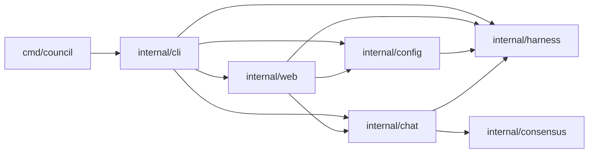
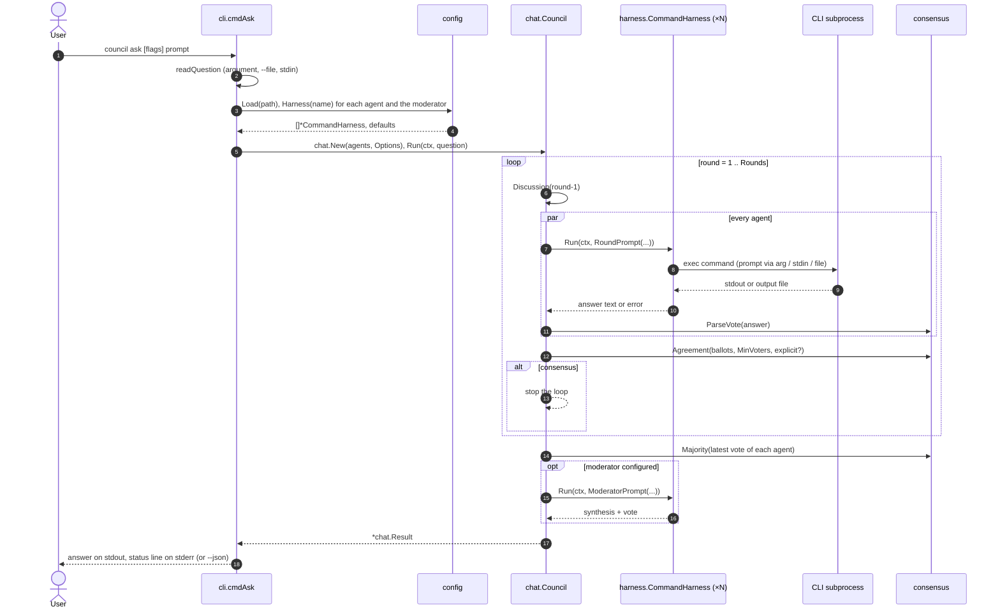

# Architecture

This document describes how council is put together: the Go packages, how
data moves between them, what happens in each round, how agents run in
parallel, the vote format, and how failures are handled.

For the user-facing overview see the [README](../README.md). The consensus
rules are in [CONSENSUS.md](CONSENSUS.md), and the harness adapters are in
[HARNESSES.md](HARNESSES.md).

## Packages

```
cmd/council/          main: run() detects whether stdin is a terminal and calls cli.Main
internal/cli/         subcommands, flag parsing, prompt assembly, live printer, result output
internal/config/      YAML config, defaults, preset overrides, the `council init` template
internal/harness/     Harness interface; CommandHarness subprocess runner; built-in presets;
                      doctor checks; JSON path lookup; Func (in-process harness)
internal/chat/        Transcript, prompt construction, Council orchestrator, Markdown rendering
internal/consensus/   vote parsing, answer normalization, agreement detection, majority vote
internal/web/         `council serve`: HTTP API, SSE run streaming, embedded single-page UI
examples/             fake-agent.sh + fake-council.yaml (demo and tests without real CLIs)
scripts/build.sh      cross-compilation into dist/
```

Dependency graph (arrows point to the imported package):



`consensus` and `harness` do not depend on anything else in the module.
`gopkg.in/yaml.v3` is the only third-party dependency, used by `config`.

### `cmd/council`

`main` only calls `run(os.Args[1:], os.Stdin, os.Stdout, os.Stderr)` and
exits with its result. `run` checks whether stdin is a character device (a
terminal) with `isTerminal` and calls `cli.Main(args, cli.Env{…})`. That flag
decides whether `council ask` without a prompt argument reads stdin. Tests call
`run` directly with in-memory streams.

### `internal/cli`

* `Main` installs a `SIGINT`/`SIGTERM` handler (`signal.NotifyContext`), so
  Ctrl-C cancels the context that every subprocess runs under. It maps errors
  to exit codes: `0` success or `-h`, `2` for `errUsage`, `1` otherwise. A
  command can also return an explicit `exitCode`, as `doctor` does.
* `parseInterspersed` lets flags appear anywhere among the positional
  arguments by calling `flag.FlagSet.Parse` repeatedly; a literal `--` ends
  flag parsing.
* `cmdAsk` assembles the prompt (`readQuestion`), resolves agents and the
  moderator through `config.Config.Harness`, builds `chat.Options` from config
  defaults and flags, runs the council, writes the optional Markdown
  transcript, and prints either JSON or the answer plus a status line.
* `livePrinter` turns `chat.Event`s into the `--verbose` output on stderr.
* `cmdDoctor`, `cmdLogin`, `cmdAgents` and `cmdInit` are thin wrappers around
  `harness.CommandHarness.Check`, `LoginCommand`, `BuildArgs` and
  `config.WriteDefault`.

### `internal/web`

`council serve` (`cmdServe`) builds a `web.Server`, an `http.Handler`, and
serves it until the context is cancelled. The handler:

* serves `static/` (embedded with `go:embed`); `index.html` is a template
  that receives the per-process CSRF token;
* checks every request's `Host` and every `POST`'s `Sec-Fetch-Site`,
  `Origin`, content type and token before routing;
* `GET /api/agents` loads the config and runs each harness's `Check`
  concurrently;
* `POST /api/run` validates a `RunRequest`, turns it into harnesses and
  `chat.Options` (as `cmdAsk` does), takes a slot from a semaphore channel,
  and runs `chat.Council.Run` in a goroutine under the request's context. The
  `OnEvent` hook forwards events through a channel to the handler, which
  writes them as Server-Sent Events. A client disconnect or
  `POST /api/runs/{id}/cancel` cancels the context, which kills the agents'
  processes.

See [WEB_UI.md](WEB_UI.md) for the event format.

### `internal/config`

* `DefaultPath` resolves the config location (`$COUNCIL_CONFIG`,
  `$XDG_CONFIG_HOME/council/…`, `~/.config/council/…`).
* `Load` returns `Default()` when the file is missing. `Parse` decodes with
  `KnownFields(true)`, fills in defaults (`applyDefaults`) and validates every
  agent and the default moderator.
* `Config.Spec(name)` turns an agent entry into a `harness.Spec`: it starts from
  the preset for the agent's kind (or an empty generic spec) and applies each
  non-empty field as an override. `Config.Harness(name)` wraps that in a
  `*harness.CommandHarness`.

### `internal/harness`

* `Harness` is the interface the chat engine uses:

  ```go
  type Harness interface {
      Name() string
      Kind() string
      Run(ctx context.Context, prompt string) (string, error)
  }
  ```

* `Spec` describes how to drive a CLI: command, argument template,
  prompt mode, stdin template, output format and source, JSON paths, timeout,
  environment, working directory, and login and status commands.
* `CommandHarness` implements `Harness` for a `Spec`. `Run` creates a temp
  directory, writes the prompt file if needed, expands the argument template
  (`BuildArgs`), starts the process with the prompt on stdin if needed, waits,
  reads stdout or the output file, and extracts the answer (`parse`/`extract`,
  using `Lookup` for JSON paths).
* `Preset(kind)` returns the built-in `Spec` for `codex`, `claude`,
  `antigravity` and `opencode`. `CanonicalKind` resolves aliases (`agy`,
  `claude-code`, `open-code`, `openai`, `custom`). `Removed` names kinds that
  no longer exist (`gemini`, `gemini-cli`), so `config` can say what to use
  instead.
* `Check` implements `council doctor` and the web UI's status badges:
  `exec.LookPath`, `--version`, then `StatusArgs`. By default exit 0 means
  signed in; a preset can also parse the output (`antigravityStatus` for
  `agy models`, `openCodeStatus` for `opencode auth list`, which always exits
  0). `Spec.SetStatusArgs`, used for a config's `status_args`, drops that
  parser.
* `configureProcess` (in `proc_unix.go` / `proc_windows.go`) puts the child in
  its own process group on Unix, so cancelling the context kills the whole
  process tree with `SIGKILL`. On Windows it does nothing.
* `Func` adapts a Go function to `Harness` for in-process fakes in tests.

### `internal/chat`

* `Transcript` is the shared, append-only, mutex-protected log of `Message`s
  (round, agent, role, content, parsed vote, error, duration, start time).
  `Discussion` renders agent messages up to a round for inclusion in a prompt.
  `Markdown` renders the whole chat for `--transcript`.
* `RoundPrompt` and `ModeratorPrompt` (in `prompts.go`) build the prompts.
* `Council.Run` is the round loop described below.

### `internal/consensus`

* `ParseVote` and `StripVote` find and remove the vote block in a message.
* `Normalize`, `Agreement` and `Majority` implement the decision rules in
  [CONSENSUS.md](CONSENSUS.md).

## Data flow of `council ask`



## Round lifecycle

`Council.Run(ctx, question)`:

1. Trim the question (an empty one is an error) and start a `Transcript`
   containing the user message (round 0).
2. For `round := 1 … Rounds`:
   1. Stop with the context's error if it was cancelled (Ctrl-C).
   2. Emit `round_start`.
   3. Render the discussion of rounds `1 … round-1` (each earlier message
      truncated to `MaxTranscriptChars` if set; failed turns appear as
      `(no response this round: <error>)`).
   4. **Run every agent concurrently** (see [Concurrency](#concurrency)). Each
      turn gets `RoundPrompt(question, self, agents, round, Rounds,
      discussion)`. The prompt contains:
      * a header: the agent's name, how many agents there are and who the
        others are, `ROUND n of at most m`, a FINAL-round warning in the last
        round (from round 2 on), and "Answer in text only: do not modify files
        or run commands that change anything";
      * `## User request`;
      * round 1: an instruction to answer independently with brief reasoning;
        later rounds: `## Discussion so far` plus instructions to critique,
        revise, converge without blindly agreeing, set `"agree": true` only
        when endorsing the answer the others now propose, and copy that
        answer's `final_answer` wording;
      * `## Response format`: the vote block template.
   5. Append every message to the transcript **in agent order** (not finish
      order). Count the agents that replied, record each parsed vote as that
      agent's latest vote, and collect this round's ballots.
   6. If no agent replied, fail: `round N: every agent failed (first error:
      …)`. The error quoted is that of the first agent in agent order.
   7. If every agent that replied also voted, call `consensus.Agreement` with
      quorum `MinVoters` (`min(2, #agents)`) and explicit agreement required
      when `RequireExplicitAgreement && round > 1`. On consensus, emit
      `consensus` and leave the loop.
   8. In the last round without consensus, emit `no_consensus`.
3. Tally each agent's latest vote with `consensus.Majority`, in agent order. If
   nobody ever voted and there is no moderator, fail with `no agent produced a
   parsable vote block`.
4. The decision is the consensus decision if there was one, otherwise the
   majority decision. `Details` is the vote-stripped prose of the
   highest-confidence supporter's message in the latest round in which a
   supporter replied.
5. If a moderator is set, run it (always, even after consensus):
   `ModeratorPrompt` contains the question, the full discussion, and the
   latest votes sorted by agent name. The moderator turn is recorded with role
   `moderator` and round `Rounds+1`. On success the method becomes
   `moderator`, the answer becomes the moderator's `final_answer` (or its
   whole reply, with a note, if it has no vote), `Details` becomes its prose,
   and supporters and dissenters are recomputed against it. On failure a note
   is added and the earlier decision stands.
6. Return the `Result` with the transcript and the latest vote of every agent.

`Result` (what `--json` prints):

| Field | Meaning |
|---|---|
| `question` | The trimmed prompt. |
| `answer` | Final answer text. |
| `details` | Explanation shown above `Final answer:` (vote block removed). |
| `method` | `unanimous`, `majority`, `moderator` or `none`. |
| `converged` | `true` only if a round reached consensus. |
| `rounds` | Rounds actually run. |
| `supporters`, `dissenters` | Agents whose latest vote matches / does not match the answer. |
| `moderator` | Moderator agent name, if any. |
| `notes` | Warnings, e.g. moderator failure. |
| `votes` | Latest vote of each agent: `{final_answer, agree, agrees_with, confidence}`. |
| `transcript` | Every message: `{round, agent, role, content, vote, error, duration_ns, time}`. Round 0 is the user, `role: moderator` is the synthesis. |

## Concurrency

* Each round starts one goroutine per agent and waits for all of them
  (`sync.WaitGroup`). A round lasts as long as its slowest agent.
* Every goroutine writes only its own slot of a pre-sized `[]Message`, so the
  round needs no lock. The messages are then added to the transcript in
  agent order on the orchestrating goroutine, which makes transcripts
  deterministic regardless of which agent finishes first.
* Progress events are emitted from the agent goroutines as soon as each turn
  finishes. `Council.emit` serializes calls to `Options.OnEvent` with a mutex,
  so the `--verbose` printer never interleaves output, but agents appear in
  completion order there.
* `Transcript` has its own mutex and returns copies, so it is safe to read
  while a round runs.
* Every subprocess runs under a context derived from the `ask` context:
  * `chat.Options.TurnTimeout` (`--timeout`) wraps each turn, including the
    moderator's;
  * the harness's own `Spec.Timeout` (agent `timeout`, default
    `defaults.timeout`) wraps the subprocess;
  * whichever deadline comes first wins; Ctrl-C cancels everything.
* On cancellation `exec.CommandContext` calls the custom `Cancel` from
  `configureProcess`, which `SIGKILL`s the child's process group on Unix.
  `WaitDelay` (3 s) bounds how long council waits for the child's output pipes
  to close afterwards, so a grandchild holding stdout cannot hang the run.
* Each turn has its own temp directory (`council-<agent>-*`) for the prompt and
  output files, removed after the turn. Concurrent turns never share files.
* No state survives between runs: every turn is a fresh CLI invocation that
  gets the whole discussion in its prompt.

## Vote format

Agents are asked to end every message with exactly one block:

````
```json
{"final_answer": "<your final answer, as concise as possible but complete>", "agree": <true|false>, "agrees_with": ["<agent names whose answer you endorse>"], "confidence": <0.0-1.0>}
```
````

| Key | Type | Meaning |
|---|---|---|
| `final_answer` (alias `answer`) | string; numbers or objects are kept as their JSON text | The agent's current answer. Required; a block without it is not a vote. |
| `agree` (alias `agreement`) | bool | The agent accepts the answer the others now propose. Missing = `false`. |
| `agrees_with` | array of strings | Informational; recorded but not used by the decision. |
| `confidence` | number, clamped to `[0, 1]` | Tie-breaker in the majority vote and for picking the explanation. Missing = 0. |

Parsing (`consensus.ParseVote`):

1. Find every fenced block whose info string is empty, `json`, `JSON`, `vote`
   or `council-vote`, and try them from last to first. The first one that
   decodes to an object with `final_answer` or `answer` wins.
2. Otherwise scan for balanced top-level `{…}` objects (string-aware), last to
   first, and take the first that contains `answer` and decodes as a vote.
3. Otherwise there is no vote: the message counts as an **abstention**. It
   stays in the transcript, but the agent has no ballot for that round.

`StripVote` removes the last valid fenced vote block, leaving the prose that is
shown as the explanation.

## Failure handling

| Situation | What happens |
|---|---|
| An agent's CLI is missing, exits non-zero, times out, prints unparsable output, or reports an error through `error_path` | The turn becomes a message with `error` set. Other agents are unaffected. Later prompts show `(no response this round: <error>)`. The agent is excluded from that round's ballots and quorum. It keeps its latest earlier vote for the final tally. |
| An agent replies without a vote | Abstention: the reply is in the transcript, but consensus is impossible in that round, because every responding agent must vote. |
| Fewer than `min(2, #agents)` votes in a round | No consensus that round. |
| Every agent fails in the same round | `council ask` fails with `round N: every agent failed (first error: …)`, exit 1. With `--transcript`, the partial transcript is still written (without a result section). |
| Nobody ever voted and there is no moderator | Fails with `no agent produced a parsable vote block`, exit 1. |
| Moderator fails | Note `moderator X failed (…); fell back to majority vote`; the consensus or majority result stands. |
| Moderator replies without a vote | Its whole reply becomes the answer, with a note. |
| No votes at all and the moderator also fails | Fails with `no agent produced a parsable vote block and the moderator gave no answer`, exit 1. The result (with the moderator note) is still in the partial transcript. |
| Ctrl-C / SIGTERM | The context is cancelled and running subprocesses are killed. `council ask` exits 1 with `context canceled` (or `round N: every agent failed (first error: …context canceled)` if a round was in progress). The partial transcript is written if `--transcript` was given. |
| Invalid config | Fails before any agent runs, with the file path and the reason. See [CONFIGURATION.md](CONFIGURATION.md#validation). |

Harness-level errors are prefixed with the agent name, for example
`claude: timed out: context deadline exceeded`,
`codex: codex exited: exit status 1: <last 800 chars of stderr>`, or
`opencode: harness reported error: invalid x-api-key`.

## Output streams

| Stream | Content |
|---|---|
| stdout | The answer (with explanation), or the `--json` document; tables from `doctor` and `agents`; `council version`. |
| stderr | Status line and `note:` lines, `--verbose` live chat, errors, usage, `council login` hints. |
