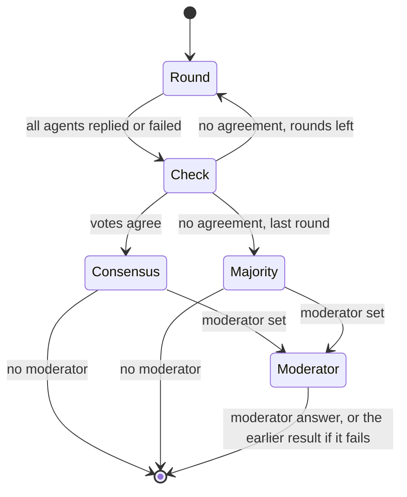

# Consensus

This document defines how council decides that the agents agree, what the
final answer is when they do not, and what the moderator does. The code is in
`internal/consensus` (vote parsing and the decision rules) and
`internal/chat/council.go` (when those rules are applied).

- [Overview](#overview)
- [Votes](#votes)
- [Normalization](#normalization)
- [Consensus in a round](#consensus-in-a-round)
- [Majority vote](#majority-vote)
- [Moderator](#moderator)
- [What gets printed](#what-gets-printed)
- [Example transcript](#example-transcript)
- [More worked examples](#more-worked-examples)
- [Tuning](#tuning)

## Overview



1. Every round, every agent replies and ends with a JSON vote.
2. After each round, the round's votes are checked for **consensus**. If
   there is consensus, the chat stops.
3. After the last round without consensus, each agent's **latest** vote is
   tallied by **majority**.
4. If a **moderator** is configured, it writes the final answer, whatever
   happened before. If it fails, the result from step 2 or 3 stands.

## Votes

Each agent is told to end its message with exactly one block:

````
```json
{"final_answer": "<your final answer, as concise as possible but complete>", "agree": <true|false>, "agrees_with": ["<agent names whose answer you endorse>"], "confidence": <0.0-1.0>}
```
````

| Key | Used for |
|---|---|
| `final_answer` (or `answer`) | The answer that is compared and tallied. Required. Non-string values (e.g. `42`) are kept as their JSON text. |
| `agree` (or `agreement`) | Explicit agreement, required for consensus from round 2 on (by default). Missing = `false`. |
| `agrees_with` | Recorded in the transcript and the `--json` output; not used by the decision. |
| `confidence` | Clamped to `[0, 1]`; missing = 0. Breaks majority ties and chooses which supporter's text is shown. |

How a vote is found in a message: the **last** fenced block (marked `json`,
`JSON`, `vote`, `council-vote`, or not marked) that parses as a vote. If there
is none, the last bare `{…}` object that contains an answer key. Code blocks in
the answer itself (Go, shell, …) are ignored, and so is any JSON block that is
not a vote.

A message without a vote is an **abstention**. The text stays in the
transcript, so the other agents still read it, but the agent casts no ballot
in that round.

## Normalization

Two answers are "the same" when their normalized forms are equal.
`consensus.Normalize`:

1. lower-cases;
2. collapses every run of whitespace (including newlines) to one space;
3. strips every `"`, `'`, `` ` `` and space at the start and end, and every
   trailing `.`, `!`, `;` and `,`, repeating until nothing changes (so
   `"Paris".` and `'Paris.'` both become `paris`).

| Answers | Same? |
|---|---|
| `42`, `42.`, ` 42`, `` `42` `` | yes |
| `Hello   World.`, `hello world` | yes |
| `"Use a Mutex!"`, `use a mutex` | yes |
| `"Paris".`, `Paris` | yes |
| `42`, `forty-two` | **no** |
| `Use sync.Mutex`, `Use a sync.Mutex` | **no** |
| `yes`, `Yes?` | **no** (`?` is not stripped) |
| `**42**`, `42` | **no** (Markdown is not stripped) |

Matching is purely textual. The round-2+ prompt therefore asks agents to copy
the exact `final_answer` wording of an answer they endorse, and to keep
`final_answer` short. Answers that mean the same thing in different words are
the main reason a run ends without consensus; a moderator handles that case
well.

## Consensus in a round

After round *r*, let **responders** be the agents whose turn did not fail and
**ballots** the votes found in their messages. The round is a consensus when
all of these hold (`consensus.Agreement`):

1. **Everyone who replied voted:** `#ballots == #responders`. One abstention
   blocks consensus for that round.
2. **Quorum:** `#ballots ≥ min(2, #agents)`. With one agent, one vote is
   enough; otherwise at least two.
3. **Same answer:** every ballot's normalized `final_answer` equals the first
   ballot's, and it is not empty.
4. **Explicit agreement:** if *r* ≥ 2 and `require_explicit_agreement` is on
   (the default; `--loose` turns it off), every ballot has `"agree": true`.
   In round 1 this is never required, so identical independent answers end
   the chat immediately.

Failed agents (timeouts, crashes, unparsable output) are not responders. They
neither block nor count toward consensus. For example, if `gemini` times out
and `codex` and `claude` agree, that is a consensus of two.

On consensus the method is `unanimous`, `converged` is `true`, the supporters
are all voters in agent order, and the answer text is the first voter's
`final_answer` exactly as written.

## Majority vote

If no round reached consensus, `consensus.Majority` tallies the **latest vote
of every agent**, taken from any round. An agent that failed in the last round
still counts with the vote it gave earlier. Ballots are taken in agent order
(the `--agents` order).

1. Group the ballots by normalized answer, ignoring empty answers.
2. Rank the groups:
   1. most supporters;
   2. then the highest **sum** of supporters' confidence;
   3. then the group whose first ballot came earliest in agent order.
3. The winning group's answer text is the `final_answer` of its most confident
   supporter. On equal confidence, the earliest one wins.
4. Supporters are the winning group's agents; dissenters are all agents in
   other groups.
5. The method is `majority`, or `unanimous` if all latest votes fall into a
   single group. That happens, for example, when everyone gave the same answer
   but someone never set `"agree": true`. Then `converged` is still `false`,
   and the status line reads `no full consensus … method: unanimous`.

If no agent ever voted and there is no moderator, the run fails with
`no agent produced a parsable vote block`.

### Tie-break example

Latest votes, in agent order `codex, claude, gemini, agy`:

| Agent | `final_answer` | `confidence` |
|---|---|---|
| codex | `Use a channel` | 0.7 |
| claude | `Use a mutex` | 0.9 |
| gemini | `use a mutex.` | 0.5 |
| agy | `Use a channel.` | 0.6 |

* Groups: `use a channel` = {codex, agy}, summed confidence 1.3;
  `use a mutex` = {claude, gemini}, summed confidence 1.4.
* Both have 2 supporters, so the higher summed confidence wins: **use a mutex**.
* The answer text comes from the most confident supporter, claude:
  `Use a mutex`.
* Result: method `majority`, supporters `claude, gemini`, dissenters
  `codex, agy`.

Had the sums also been equal, `use a channel` would have won, because its
first ballot (codex) comes earlier in agent order.

## Moderator

`--moderator NAME` or `defaults.moderator: NAME` (anything other than
`majority`; `--moderator` also accepts `vote` and `none` to mean majority)
adds a final synthesis turn. It runs **after** the decision above, whether or
not the chat converged. The moderator:

* can be any agent, including one of the participants (it runs as a separate,
  fresh invocation);
* gets a prompt naming it MODERATOR, with the user request, the full discussion
  of all rounds (subject to `max_transcript_chars`), and the latest votes
  sorted by agent name, e.g.
  `- claude: "Use a mutex" (agree=false, confidence=0.90)`;
* is asked to prefer the best-supported, best-argued position, resolve
  disagreements explicitly, note important caveats or dissent, and end with
  its own vote block;
* gets the same `--timeout` as the other turns, and its own `timeout`.

Outcome:

| Moderator result | Final answer | Method | Notes |
|---|---|---|---|
| Reply with a vote | its `final_answer` | `moderator` | Supporters/dissenters are recomputed: agents whose latest vote normalizes to the moderator's answer support it. |
| Reply without a vote | its whole reply (prose) | `moderator` | `note: moderator gave no vote block; using its full reply as the answer` |
| Failure (crash, timeout, error) | the consensus or majority answer | unchanged | `note: moderator X failed (…); fell back to majority vote` |

`converged` keeps its meaning (whether a round reached consensus), even when
the moderator decides. The moderator's message is in the transcript with role
`moderator`.

## What gets printed

* **Answer:** the decision's answer (`Final answer: …`).
* **Explanation:** for a moderator decision, the moderator's reply without its
  vote block. Otherwise, the reply of the most confident supporter in the
  latest round where a supporter replied (on a tie, the agent latest in agent
  order), without the vote block. It is printed above `Final answer:` unless
  it equals the answer.
* **Status line** (stderr): `consensus` or `no full consensus`, the rounds run,
  the method (with the moderator's name), `for:` supporters and `against:`
  dissenters.

## Example transcript

Three fake agents from `examples/fake-council.yaml`: `alpha` and `beta` answer
42; `gamma` answers 41, then follows the majority. Default settings: 3 rounds,
majority, explicit agreement required.

```sh
council ask --config examples/fake-council.yaml --transcript chat.md "What is 6 * 7?"
```

**Round 1.** Each agent sees only the request. Ballots: alpha `42`, beta `42`,
gamma `41`. Everyone voted and the quorum is met, but the answers differ, so
there is no consensus.

**Round 2.** This is the prompt gamma received (the other agents' prompts
differ only in the first line):

````text
You are "gamma", one of 3 AI agents in a group chat that must reach a consensus answer to the user's request. The other participants are: alpha, beta.

This is ROUND 2 of at most 3.
Answer in text only: do not modify files or run commands that change anything.

## User request

What is 6 * 7?

## Discussion so far

### Round 1

#### alpha
[alpha] Working independently: my answer is 42.

```json
{"final_answer": "42", "agree": false, "confidence": 0.6}
```

#### beta
[beta] Working independently: my answer is 42.

```json
{"final_answer": "42", "agree": false, "confidence": 0.6}
```

#### gamma
[gamma] Working independently: my answer is 41.

```json
{"final_answer": "41", "agree": false, "confidence": 0.6}
```

## Instructions

Critically review the other agents' latest answers: point out mistakes, acknowledge correct points, and revise your own answer if you are persuaded. Aim to converge on the single best answer, but do not agree just to be agreeable.
Set "agree": true only if your final_answer is the same answer the others are now proposing and you endorse it. When you endorse another agent's answer, copy its final_answer wording so the votes can be matched.

## Response format

End your message with exactly one fenced JSON vote block:

```json
{"final_answer": "<your final answer, as concise as possible but complete>", "agree": <true|false>, "agrees_with": ["<agent names whose answer you endorse>"], "confidence": <0.0-1.0>}
```
````

The Markdown transcript written by `--transcript chat.md`:

````markdown
# Council transcript

## Question

What is 6 * 7?

## Round 1

### alpha _(2ms)_

[alpha] Working independently: my answer is 42.

```json
{"final_answer": "42", "agree": false, "confidence": 0.6}
```

### beta _(2ms)_

[beta] Working independently: my answer is 42.

```json
{"final_answer": "42", "agree": false, "confidence": 0.6}
```

### gamma _(204ms)_

[gamma] Working independently: my answer is 41.

```json
{"final_answer": "41", "agree": false, "confidence": 0.6}
```

## Round 2

### alpha _(6ms)_

[alpha] Having read the others, I stand by 42; it matches the majority.

```json
{"final_answer": "42", "agree": true, "confidence": 0.8}
```

### beta _(6ms)_

[beta] The others now agree with my answer 42. Agreed.

```json
{"final_answer": "42", "agree": true, "confidence": 0.9}
```

### gamma _(207ms)_

[gamma] I reviewed the other answers; the majority answer 42 is right and my 41 was a mistake. Revising.

```json
{"final_answer": "42", "agree": true, "confidence": 0.8}
```

## Result

- **Answer:** 42
- **Method:** unanimous
- **Converged:** true after 2 round(s)
- **Supporters:** alpha, beta, gamma
````

Round 2 ballots: `42`/agree, `42`/agree, `42`/agree. Everyone voted, the quorum
is met, the answers are equal, and everyone agreed, so this is a consensus.
Round 3 is skipped. The explanation comes from beta, the most confident
supporter in round 2:

```
[beta] The others now agree with my answer 42. Agreed.

Final answer: 42
── consensus after 2 round(s) · method: unanimous · for: alpha, beta, gamma
```

## More worked examples

### A holdout: majority, then moderator

Agents `alpha` (42, follows the majority), `beta` (42, stubborn) and `delta`
(7, stubborn), with `--rounds 2`:

| Round | alpha | beta | delta | Consensus? |
|---|---|---|---|---|
| 1 | `42` | `42` | `7` | no: answers differ |
| 2 | `42`, agree | `42`, agree | `7`, agree=false | no: answers differ |

Majority over the latest votes: `42` (alpha, beta) beats `7` (delta).

```
── no full consensus after 2 round(s) · method: majority · for: alpha, beta · against: delta
```

With `--moderator judge`, the judge reads both rounds and the tally and votes
`42`:

```
As moderator (judge) I reviewed every round. The group's strongest, best-supported answer is 42; the remaining objections were addressed in the discussion.

Final answer: 42
── no full consensus after 2 round(s) · method: moderator (judge) · for: alpha, beta · against: delta
```

### Same answer, but no explicit agreement

Round 2 ballots `Use a mutex` (agree), `use a mutex.` (agree) and
`Use a mutex` (**agree=false**). The answers match after normalization, but
explicit agreement is required from round 2 on, so this is not a consensus and
the chat continues. If the last round ends the same way, the majority tally
has a single group: method `unanimous`, `converged: false`. With `--loose`, the
same round would have been a consensus.

### An agent fails

Three agents, and gemini times out in round 2. In round 2, codex and claude both
vote `B` with `agree: true`. The responders are codex and claude, both voted,
2 ≥ quorum 2, so this is a consensus on `B` with supporters codex and claude.
gemini's round-1 vote is not used, because the consensus decision only
considers the round that converged. With `--verbose` you see
`✗ error: gemini: timed out: context deadline exceeded`.

### An agent forgets the vote

Round 2: codex and claude vote `B` with `agree: true`, and gemini replies with
prose but no vote block. gemini is a responder without a ballot, so the round
cannot be a consensus. If this repeats in the last round, the majority tally
uses gemini's latest vote from an earlier round, if it has one.

## Tuning

| Goal | Setting |
|---|---|
| Stop as soon as answers match, without explicit `agree` | `--loose` or `require_explicit_agreement: false` |
| Give agents more chances to converge | `--rounds 4` or `defaults.rounds` |
| A written synthesis instead of a bare vote | `--moderator <agent>` |
| Fewer tokens per round | `--max-context N` (each earlier message is cut to N bytes; this can also cut off its vote block) |
| Deterministic tie-breaks | order `--agents` by trust: earlier agents win exact ties |
